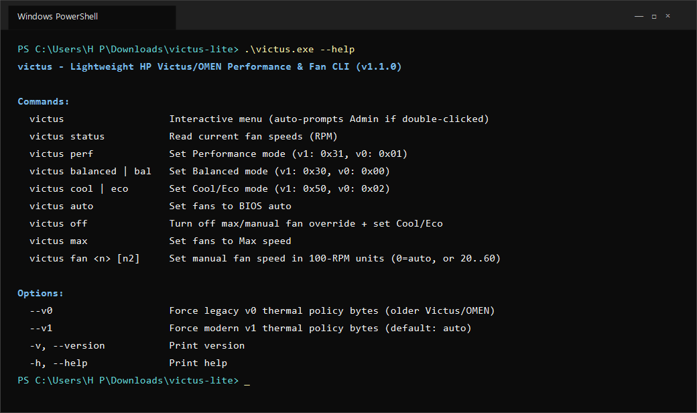

# victus-lite (`victus`)

A lightweight, zero-dependency C++17 CLI and interactive utility for controlling performance modes and fan behavior on **HP Victus** and **HP OMEN** laptops.

It communicates directly with HP's ACPI/WMI BIOS interface (`ROOT\WMI`, class `hpqBIntM`) without kernel drivers (such as WinRing0), background services, telemetry, or OMEN Gaming Hub bloat.



---

## Features

- **Zero background footprint:** Runs only when invoked and exits immediately.
- **No third-party dependencies:** Uses standard Windows COM / WMI APIs (`ole32`, `oleaut32`, `wbemuuid`, `shell32`).
- **Performance / Thermal Mode switching:** `Balanced`, `Performance`, and `Cool / Eco` (automatic **v1** with **v0** fallback, plus `--v0` / `--v1` overrides).
- **Fan control:** `Auto`, `Max`, `Off` (disables max/manual overrides + enables Cool/Eco), and manual RPM level setting (when permitted by BIOS).
- **Live fan telemetry:** Reads current Fan 1 and Fan 2 speeds in RPM.
- **Safety clamping:** Manual fan targets are clamped to `0` (Auto) or `20..60` (2000–6000 RPM).
- **Double-click UAC prompt:** Running `victus.exe` interactively without arguments automatically prompts for Administrator rights.

---

## Requirements

- **Hardware:** HP Victus or HP OMEN laptop exposing the `hpqBIntM` WMI class (`ACPI\PNP0C14\0`).
- **OS:** Windows 10 / Windows 11 (x64).
- **Privileges:** **Administrator** rights are required at runtime because Windows restricts `ROOT\WMI` `hpqBIntM` access to elevated processes (`-h` / `--help` works without elevation).
- **Compiler (to build from source):** Any of:
  - MinGW-w64 `g++` (e.g., `w64devkit`)
  - MSVC (`cl.exe` from Visual Studio / Build Tools)
  - Clang (`clang++`)

---

## Project Structure

| File | Description |
| :--- | :--- |
| `hp_wmi.hpp` | Header-only C++17 COM/WMI wrapper (`hp::WmiController`) for `hpqBIntM` / `hpqBDataIn`. |
| `main.cpp` | CLI argument parser, elevation check, RPM clamping, and interactive menu. |
| `build.bat` | Build script supporting MSVC (`cl`), MinGW (`g++`), and Clang (`clang++`). |
| `setup.ps1` | Checks requirements (64-bit Windows, `hpqBIntM`, C++ compiler), installs `w64devkit` if missing, and builds `victus.exe`. |
| `.github/workflows/build.yml` | GitHub Actions CI workflow that builds, smoke-tests, and packages `victus.exe`. |
| `assets/screenshot.png` | CLI help output screenshot. |
| `LICENSE` | MIT License. |
| `.gitignore` | Ignores compiled binaries and build/IDE artifacts. |

---

## Setup & Building

### Automatic Setup (Recommended)

Run `setup.ps1` to verify requirements (64-bit Windows, `hpqBIntM` WMI class, C++17 compiler), automatically download and install `w64devkit` (`g++`) if no compiler is found, and build `victus.exe`:

```powershell
powershell -ExecutionPolicy Bypass -File .\setup.ps1 -AddToPath
```

Useful flags:
- `-CheckOnly`: Verify requirements without installing anything or building.
- `-AddToPath`: Add the repository folder to your User `PATH` so `victus` can be run from any terminal.

### Manual Build

Open a terminal in the repository folder and run:

```bat
build.bat
```

Or compile manually with `g++`:

```powershell
g++ -std=c++17 -O2 -Wall -Wextra main.cpp -o victus.exe -lole32 -loleaut32 -lwbemuuid
```

Or with MSVC (`x64 Native Tools Command Prompt`):

```bat
cl /std:c++17 /O2 /EHsc /W4 main.cpp ole32.lib oleaut32.lib wbemuuid.lib /Fe:victus.exe
```

*(Optional)* Add the folder containing `victus.exe` to your User `PATH` so you can run `victus` from anywhere.

---

## Usage

Open **Terminal (Admin)** (`Win + X` → **Terminal (Admin)**).

### CLI Commands

| Command | Aliases / Flags | Action |
| :--- | :--- | :--- |
| `victus` | — | Launch the interactive menu (auto-prompts UAC if not elevated) |
| `victus status` | `st` | Print current Fan 1 and Fan 2 speeds (RPM) |
| `victus perf` | `performance` | Set **Performance** thermal profile (v1: `0x31`, v0: `0x01`) |
| `victus balanced` | `bal` | Set **Balanced** thermal profile (v1: `0x30`, v0: `0x00`) |
| `victus cool` | `eco` | Set **Cool / Eco** thermal profile (v1: `0x50`, v0: `0x02`) |
| `victus auto` | `fan-auto` | Disable Max override and return fans to BIOS Auto |
| `victus off` | — | Turn off Max/manual fan overrides (`0x27`/`0x2E`) and switch to **Cool / Eco** |
| `victus max` | `fan-max` | Force fans to **Max** speed |
| `victus fan <n> [n2]` | `fan-set` | Set manual speed in 100-RPM units (`0` = auto, `20..60` = 2000–6000 RPM) |
| `--v0` / `--v1` | *(flag)* | Force legacy v0 or modern v1 thermal policy bytes (default: try v1, fallback to v0) |
| `victus --version` | `-v`, `version` | Print version (does not require Admin) |
| `victus --help` | `-h`, `help` | Print command help (does not require Admin) |

### Examples

```powershell
victus status          # Check current fan RPM
victus perf            # High performance profile for gaming/heavy work
victus max             # Force maximum fan cooling
victus off             # Disable max/manual fan override and switch to Cool/Eco
victus fan 35          # Set both fans to 3500 RPM (if supported by BIOS)
victus fan 35 40       # Set Fan 1 to 3500 RPM and Fan 2 to 4000 RPM
victus auto            # Return fans to default BIOS curve
```

---

## How It Works (HP WMI BIOS Protocol)

`hp::WmiController` connects to the `ROOT\WMI` namespace, locates the active `hpqBIntM` instance, and invokes `hpqBIOSInt0` or `hpqBIOSInt128` with an `hpqBDataIn` object:

- **`Sign`:** `"SECU"` (`0x53, 0x45, 0x43, 0x55`)
- **`Command`:** `0x20008`
- **`CommandType` opcodes:**

| CommandType | WMI Method | Payload | Purpose |
| :--- | :--- | :--- | :--- |
| `0x1A` | `hpqBIOSInt0` | `{ 0xFF, mode }` | Set thermal policy (`0x30` Balanced, `0x31` Performance, `0x50` Cool/Eco) |
| `0x27` | `hpqBIOSInt0` | `{ 0x01 }` or `{ 0x00 }` | Enable (`0x01`) or disable (`0x00`) Max fan mode |
| `0x2D` | `hpqBIOSInt128` | *(empty)* | Read current fan speeds; output bytes represent `RPM / 100` |
| `0x2E` | `hpqBIOSInt0` | `{ fan1_x100, fan2_x100 }` | Set manual fan target levels in 100-RPM units (`0` = BIOS Auto) |

---

## Supported Models & Compatibility

Compatibility depends on which HP BIOS thermal policy version (**v1** vs. **v0**) your motherboard firmware uses:

| Hardware Variant | Support Status | Details |
| :--- | :--- | :--- |
| **Newer HP Victus 15** (`15-fb3xxx`, `15-fa1xxx+`, Ryzen 7000+ / Intel 13th+ Gen, RTX 40-series) | **Supported (v1)** | Uses v1 thermal policy bytes (`0x30` Balanced, `0x31` Performance, `0x50` Cool). `status`, `perf`, `bal`, `cool`, `auto`, `off`, and `max` work; custom `fan <n>` (`0x2E`) may be locked by BIOS on some Victus 15 models. |
| **Newer HP Victus 16 & OMEN** (`16-r`, `16-s` series, modern OMEN laptops) | **Supported (v1)** | Uses v1 thermal policy bytes (`0x30` / `0x31` / `0x50`). Typically also supports manual `fan <n>` (`0x2E`) RPM control. |
| **Older HP Victus 15 / 16 & OMEN** (11th/12th Gen Intel `15-fa0xxx`, `16-d0xxx`, Ryzen 5000 `16-e0xxx`, RTX 30-series) | **Supported (v0 auto-fallback)** | Uses legacy v0 thermal policy bytes (`0x00` Balanced, `0x01` Performance, `0x02` Cool). `victus` automatically falls back to v0 if v1 is rejected, or pass `--v0` explicitly. |
| **Non-gaming HP laptops & non-HP PCs** (Pavilion, Envy, ProBook, etc.) | **Not Supported** | Lacks the HP OMEN/Victus `hpqBIntM` thermal WMI interface. |

---

## Notes & Limitations

- **Why `victus off` does not force permanent 0 RPM:** HP's Embedded Controller (EC) and BIOS enforce minimum thermal safety curves. Sending `0` (`victus fan 0` or `victus off`) cancels manual/max overrides and hands control back to the BIOS in **Cool / Eco** mode so fans spin down as low as firmware permits (or stop at low idle temperatures if supported by your BIOS). Under load, the BIOS will still spin fans up to prevent overheating.
- **Victus 15 manual RPM support:** Some HP Victus 15 BIOS versions only expose **Auto** and **Max** (`0x27`) and ignore or reject custom `0x2E` RPM levels, or revert manual levels after a short timeout unless refreshed.
- **Admin requirement:** If you see `[FATAL] No hpqBIntM instance found`, verify you are running in an **Administrator** terminal on an HP OMEN/Victus system.

---

## Disclaimer & License

This software interacts directly with undocumented HP BIOS/WMI interfaces (`hpqBIntM`). It is provided **AS-IS**, without warranty of any kind — use it at your own risk.

Licensed under the [MIT License](LICENSE).
